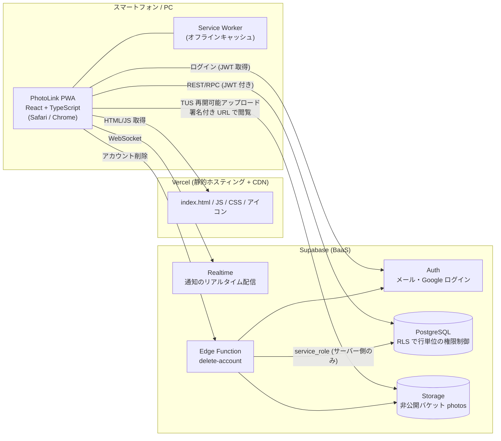
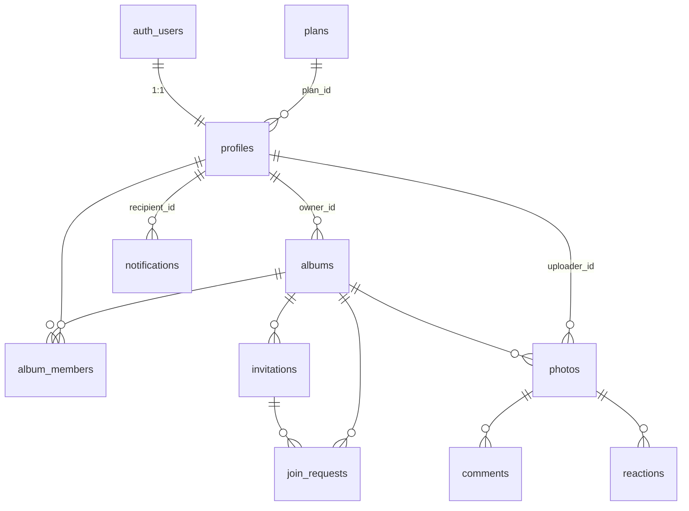
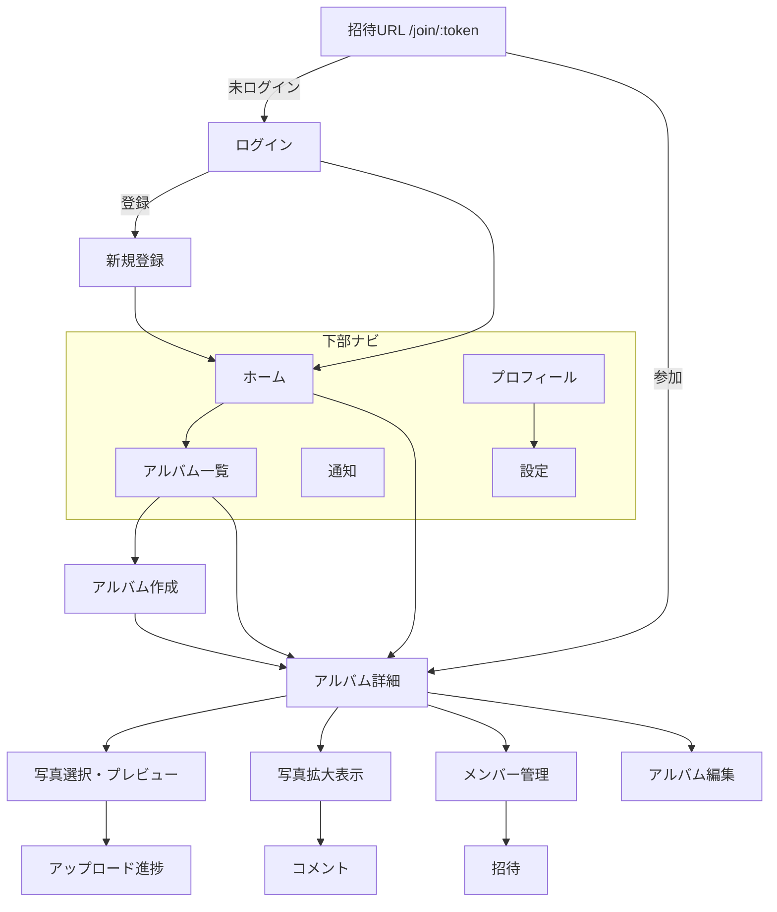
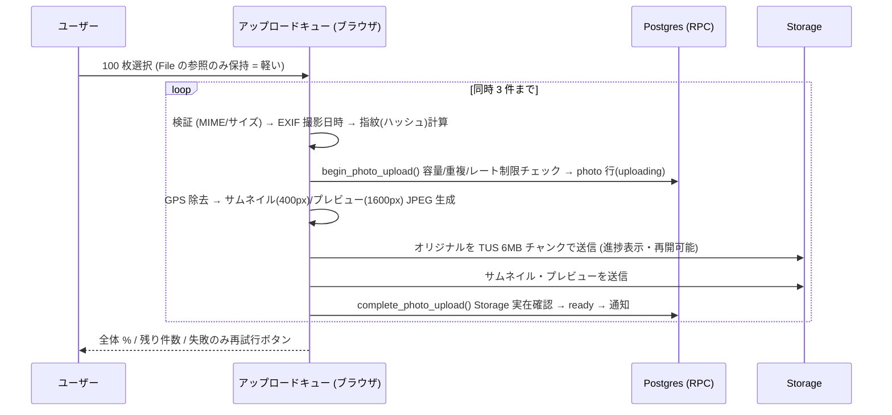

# PhotoLink 設計書

「大切な人たちと、写真や思い出を簡単に共有できるプライベートアルバム」

この文書は指示書 17 章「最初に実施すること」の 10 項目をまとめたものです。
用語の補足は文末の「用語集」を参照してください。

---

## 1. システム全体構成図



- **サーバーを自前で持たない構成**です。フロントエンドは Vercel で配信し、データ・認証・ファイルは Supabase に任せます。
- 権限チェックはすべて **データベース側 (RLS / SECURITY DEFINER 関数) と Storage ポリシー**で行います。フロントエンドのチェックは「表示の都合」であり、セキュリティの根拠にはしません。
- 管理者権限キー (`service_role`) は Edge Function の中だけで使用し、ブラウザには絶対に渡しません。

## 2. 採用技術と選定理由

| 区分 | 技術 | 理由 |
|---|---|---|
| UI | React 19 + TypeScript | 指示書指定。型でバグを減らし、将来の保守を容易に |
| ビルド | Vite 7 | 高速・設定が少ない。PWA プラグインが成熟 |
| スタイル | Tailwind CSS 4 | レスポンシブ / ダークモード / Safe Area をクラスで素早く実装 |
| ルーティング | React Router 7 | 標準的。招待 URL `/join/:token` などのディープリンクに対応 |
| サーバー状態 | TanStack Query 5 | キャッシュ・無限スクロール・再取得を少ないコードで |
| クライアント状態 | Zustand | アップロードキューを画面遷移しても保持するため |
| BaaS | Supabase (PostgreSQL / Auth / Storage / Realtime) | 指示書指定。RLS で「アルバム参加者だけ」の制御を DB に集約できる |
| 大容量アップロード | tus-js-client (TUS プロトコル) | Supabase Storage が公式対応。通信断から**途中再開**できる |
| EXIF 解析 | exifr | 撮影日時の取得。軽量 |
| HEIC 変換 | heic2any (遅延読み込み) | Chrome/Android で HEIC のサムネイルを作るため。必要な時だけ読み込む |
| PWA | vite-plugin-pwa (Workbox) | manifest / Service Worker を自動生成 |
| アイコン | lucide-react | 線の太さが統一されたアイコンセット |
| ホスティング | Vercel | 指示書指定。GitHub 連携で push → 自動デプロイ |
| ネイティブ化 | Capacitor (将来) | 同じ Web コードを iOS/Android アプリに包める |

**指示書からの変更点はありません。** 追加ライブラリ (TanStack Query, Zustand, tus-js-client, exifr, heic2any) は指定構成の範囲内の補助です。

## 3. ディレクトリ構成

```
photo-link/
├── docs/                    設計書・セットアップ手順・進捗・テスト記録
├── public/                  アイコン・静的ファイル
├── scripts/                 アイコン生成などの補助スクリプト
├── supabase/
│   ├── config.toml          Supabase CLI 設定
│   ├── migrations/          DB マイグレーション (テーブル / RLS / Storage / 関数)
│   ├── functions/
│   │   └── delete-account/  アカウント削除 Edge Function
│   └── tests/               RLS の自動テスト (SQL)
├── src/
│   ├── main.tsx / App.tsx   エントリポイント・ルーティング
│   ├── index.css            Tailwind・テーマ・Safe Area
│   ├── lib/                 supabase クライアント, 署名付き URL キャッシュ, 共通関数
│   ├── types/               DB の型定義
│   ├── features/
│   │   ├── auth/            ログイン・登録・パスワード再設定
│   │   ├── albums/          アルバム一覧・詳細・作成・編集
│   │   ├── members/         メンバー管理・招待・参加承認
│   │   ├── photos/          グリッド・拡大表示・ダウンロード
│   │   ├── upload/          写真選択・キュー・進捗・GPS 除去・サムネイル生成
│   │   ├── social/          コメント・リアクション
│   │   ├── notifications/   アプリ内通知
│   │   └── profile/         プロフィール・設定・アカウント削除
│   └── components/          ボタン・下部ナビ・シートなど共通 UI
├── .env.example             環境変数の見本 (本物の .env は Git 管理外)
├── vercel.json              SPA ルーティング・セキュリティヘッダー
└── vite.config.ts
```

## 4. データベース設計



| テーブル | 主な列 | 制約・インデックス |
|---|---|---|
| `plans` | id(text PK: free/plus), name, max_albums, max_storage_bytes, max_video_bytes, max_video_duration_sec, features(jsonb) | 将来の Stripe 連携用に `stripe_price_id` |
| `profiles` | id(uuid PK→auth.users ON DELETE CASCADE), display_name, avatar_path, plan_id(FK), created_at, updated_at | display_name 1–40 文字 |
| `albums` | id(uuid PK), owner_id(FK profiles), title, description, cover_photo_id(FK photos, SET NULL), photo_count, member_count, created_at, updated_at | title 1–80 文字、owner_id インデックス |
| `album_members` | (album_id, user_id) 複合 PK, role('owner'\|'member'), joined_at | user_id インデックス |
| `invitations` | id, album_id, created_by, token(32 byte 乱数 base64url, UNIQUE), code(8 文字, UNIQUE), requires_approval, expires_at, max_uses, use_count, revoked_at, created_at | 期限・無効化・利用回数上限 |
| `join_requests` | id, album_id, invitation_id, user_id, status('pending'\|'approved'\|'rejected'), created_at, decided_at, decided_by | (album_id,user_id) で pending は 1 件のみ (部分ユニーク) |
| `photos` | id, album_id, uploader_id, media_type('image'\|'video'), status('uploading'\|'ready'), storage_path, thumb_path, preview_path, mime_type, size_bytes, width, height, duration_sec, original_filename, content_hash, taken_at, sort_at(生成列), created_at, updated_at | (album_id, sort_at desc, id) 表示用、(album_id, uploader_id)、**(album_id, content_hash) 部分ユニーク = 重複防止** |
| `comments` | id, photo_id, album_id, author_id, body(1–1000 文字), created_at | (photo_id, created_at) |
| `reactions` | (photo_id, user_id, emoji) 複合 PK, album_id, created_at | 許可する絵文字を CHECK で限定 |
| `notifications` | id, recipient_id, actor_id, album_id, photo_id, type, data(jsonb), read_at, created_at | (recipient_id, created_at desc)、未読用部分インデックス |
| `rate_limit_events` | id, user_id, action, created_at | (user_id, action, created_at) — レート制限 |
| `usage_daily` | (user_id, day) PK, uploaded_bytes, uploaded_files | コスト把握用の日次集計 |

- すべての主要テーブルに `created_at`、更新されるテーブルには `updated_at` (トリガーで自動更新)。
- `photo_count` / `member_count` はトリガーで自動更新 (一覧表示を高速化)。
- 通知はトリガー (SECURITY DEFINER) で自動作成。クライアントは通知を作れません。
- 詳細は `supabase/migrations/` の SQL が正です。

## 5. 画面一覧・画面遷移図

| # | 画面 | パス |
|---|---|---|
| 1 | ログイン | `/login` |
| 2 | 新規登録 | `/signup` |
| – | パスワード再設定 | `/forgot-password`, `/reset-password` |
| 3 | ホーム (最近の写真・アルバム) | `/` |
| 4 | アルバム一覧 | `/albums` |
| 5 | アルバム詳細 (写真グリッド) | `/albums/:albumId` |
| 6 | アルバム作成 / 編集 | `/albums/new`, `/albums/:albumId/edit` |
| 7 | 写真選択 | `/albums/:albumId/upload` (選択 + プレビュー) |
| 8 | 一括アップロード | 同上 (選択後にキューへ投入) |
| 9 | アップロード進捗 | `/uploads` (全アルバム共通キュー) |
| 10 | 写真拡大表示 | `/albums/:albumId/photos/:photoId` |
| 11 | コメント | 拡大表示内のシート |
| 12 | メンバー管理 | `/albums/:albumId/members` |
| 13 | 招待 (発行 / 参加) | `/albums/:albumId/invite`, `/join/:token`, `/join` (コード入力) |
| 14 | 通知 | `/notifications` |
| 15 | プロフィール | `/profile` |
| 16 | 設定 | `/settings` |



下部ナビ: **ホーム / アルバム / ＋(投稿) / 通知 / プロフィール**。中央の「＋」から最短 2 タップで写真選択を開けます。

## 6. Android・iPhone 対応方針

| 項目 | iPhone (Safari) | Android (Chrome) | 実装 |
|---|---|---|---|
| ホーム画面追加 | 共有 → 「ホーム画面に追加」(自動プロンプトなし) | `beforeinstallprompt` でインストールボタン | 設定画面に OS 別の案内とボタン |
| Safe Area | ノッチ / Dynamic Island / ホームインジケーター | ジェスチャーバー | `viewport-fit=cover` + `env(safe-area-inset-*)` |
| 写真の複数選択 | `<input type=file multiple accept="image/*,video/*">` → 写真ピッカー | Android 13+ は Photo Picker | 同一コードで両対応 |
| カメラ撮影 | `capture="environment"` 付き input | 同左 | 「撮影」ボタンを別に用意 |
| HEIC | Safari は HEIC を表示可能。ピッカーが JPEG に自動変換する場合あり | Chrome は HEIC を表示不可 | オリジナルは HEIC のまま保存。サムネイル/プレビューは JPEG で生成 (必要時 heic2any) |
| Live Photos | Web では静止画のみ取得される (動画部分は取得不可) | – | 静止画として保存。仕様として明記 |
| iCloud 上の写真 | ダウンロード中の読み込み失敗がありうる | – | 読み込みエラーを個別表示し「再試行」 |
| 動画 | MOV (HEVC/H.264) | MP4/WebM | MIME と拡張子で検証。再生は `<video playsinline>` |
| ダウンロード | `<a download>` が不安定 → **共有シート (Web Share API) で「画像を保存」** | `<a download>` | 端末判定ではなく `navigator.canShare({files})` の機能判定で分岐 |
| 招待共有 | 共有シート | 共有シート | Web Share API → 不可なら LINE リンク / クリップボード |
| バックグラウンド | 画面を閉じるとアップロード停止 | 同左 | 画面ロック・タブ離脱を警告。TUS により再開時は続きから |
| Web Push | iOS 16.4+ かつ **ホーム画面追加後のみ** | 対応 | Phase 5 以降。まずアプリ内通知 + Realtime |

**特定ブラウザ専用 API には依存せず**、機能判定 (feature detection) で分岐します。

## 7. 大量アップロードの実装方式



- **画面が固まらない**: 選択直後は `File` の参照だけを保持し、プレビューは表示中のものだけ `URL.createObjectURL`。サムネイル生成は同時 2 件に制限し、終わったら即解放。
- **メモリ抑制**: オリジナル全体を読み込むのは画像の GPS 除去とハッシュ計算時のみ (画像は数 MB)。動画は先頭・末尾の一部だけ読み込み `Blob` を合成 (コピーしない)。
- **同時実行数**: 3 (設定で変更可能)。
- **キュー状態の保持**: Zustand のグローバルストアに保持し、画面遷移しても継続。アップロード中のページ離脱は警告。
- **再試行**: ネットワークエラーは指数バックオフで自動 3 回、その後は「失敗」として個別に再試行ボタン。
- **重複防止**: 画像は SHA-256、動画は「サイズ + 先頭/末尾 1MB の SHA-256」を指紋とし、`(album_id, content_hash)` の部分ユニーク制約で DB が最終判定。
- **原本保持**: オリジナルを必ず保存 (GPS 情報のみ同じバイト長で 0 埋め)。圧縮版はサムネイル・プレビューとして別ファイル。
- **未完了の掃除**: 24 時間以上 `uploading` のままの行は `cleanup_stale_uploads()` で削除 (pg_cron で定期実行可能)。

## 8. セキュリティ設計

| 脅威 | 対策 |
|---|---|
| 他人のアルバムを見る | 全テーブル RLS。`is_album_member()` 関数で判定。Storage も同じ関数でパス `album_id/...` を検査 |
| 画像 URL の流出 | **非公開バケット**。表示は有効期限 1 時間の署名付き URL のみ |
| 招待 URL だけで閲覧 | 招待はログイン必須。トークンで見られるのはアルバム名・人数のみ。参加 (または承認) 後に初めて閲覧可 |
| 招待コード総当たり | トークン 256bit 乱数、コード 8 文字 (32 種 ^8 ≈ 1.1 兆通り)、失敗 10 回/時間で拒否、期限・回数上限・無効化 |
| 権限昇格 | ロール変更・メンバー追加は SECURITY DEFINER 関数経由のみ。直接 INSERT は不可 |
| 不正ファイル | クライアント検証 + **バケット側で MIME 許可リストとサイズ上限** + DB 側でも MIME/サイズ CHECK |
| 大量投稿 (DoS) | `rate_limit_events` による 1 分あたり投稿数・招待発行数制限、プラン別容量上限 |
| XSS | React の自動エスケープ。`dangerouslySetInnerHTML` 不使用。CSP ヘッダー (vercel.json) |
| 位置情報漏えい | 画像 EXIF の GPS を**アップロード前に端末内で消去**。動画の位置メタデータもベストエフォートで消去。DB に GPS は保存しない |
| キー漏えい | ブラウザには anon キーのみ (RLS 前提で公開可)。service_role は Edge Function の環境変数のみ。`.env` は Git 管理外 |
| アカウント削除 | Edge Function で本人確認 → 自分の写真ファイル・所有アルバム (全写真) を Storage から削除 → auth ユーザー削除 → DB は CASCADE |

## 9. MVP の実装範囲

**MVP (今回実装)**

- メール認証 (登録 / ログイン / ログアウト / パスワード再設定)、Google ログイン (Supabase 側設定が必要)
- プロフィール (名前・アイコン)、アカウント削除
- アルバム CRUD、カバー画像、人数・枚数表示
- 招待 URL / コード、LINE 共有、期限・無効化・承認制、メンバー一覧・退会・除外
- 写真・動画の複数選択 / 撮影 / プレビュー / 一括アップロード / 個別進捗 / 失敗のみ再試行 / 重複防止 / GPS 除去 / サムネイル生成
- グリッド (月別見出し・無限スクロール・投稿者絞り込み)、拡大表示 (スワイプ)、動画再生、ダウンロード、削除
- コメント・いいね・絵文字リアクション・リアクションした人の表示
- アプリ内通知 (Realtime で即時反映)
- PWA (ホーム画面追加、ダークモード、Safe Area)
- プラン・利用上限・日次利用量の記録

**MVP 後 (未実装・予定)**

- Web Push 通知、一括 ZIP ダウンロード、高度な検索、フォトブック、決済 (Stripe)
- Capacitor によるネイティブアプリ化、写真の並び替え・アルバム間移動
- オーナー権限の譲渡

## 10. 月額運用コストの概算

※ 2026 年時点で公開されている料金体系をもとにした**目安**です。契約前に各社の料金ページで必ず最新額を確認してください。

| 規模 | 想定 | Supabase | Vercel | 合計目安 |
|---|---|---|---|---|
| 開発・身内テスト | 〜10 人、写真 〜2,000 枚 (約 1GB) | Free: $0 (Storage 1GB / 転送 5GB / 一定期間無操作で一時停止) | Hobby: $0 (非商用) | **$0** |
| 小規模公開 | 〜300 人、写真 〜5 万枚 (約 100GB) | Pro: $25 (Storage 100GB・転送 250GB 込み) | Pro: $20 (商用利用時) | **約 $45 (約 7,000 円)** |
| 中規模 | 〜3,000 人、約 1TB、転送 1TB | Pro $25 + 超過 Storage 約 900GB×$0.021 ≈ $19 + 超過転送 約 750GB×$0.09 ≈ $68 | $20 | **約 $130 (約 2 万円)** |

- 最大のコスト要因は **Storage 容量と転送量 (画像を見る回数)**。サムネイル (約 40KB) とプレビュー (約 300KB) で一覧・閲覧の転送量を大幅に削減し、オリジナルはダウンロード時のみ転送します。
- `usage_daily` テーブルと `storage_usage_by_user` ビューでユーザー別の利用量を把握できます。
- 独自ドメインは年 1,500〜3,000 円程度。

---

## 用語集

- **RLS (Row Level Security)**: データベースの行ごとに「誰が読めるか/書けるか」を決める仕組み。アプリにバグがあっても DB が拒否してくれます。
- **署名付き URL**: 一定時間だけ有効な秘密の URL。期限が切れると見られなくなります。
- **PWA**: Web サイトをアプリのようにホーム画面に追加して使える仕組み。
- **TUS**: 大きなファイルを小分けで送り、途中で切れても続きから再開できる通信方式。
- **SECURITY DEFINER 関数**: DB の中で特別な権限で動く関数。権限チェックを関数内で厳密に行い、決められた操作だけを許可します。
- **Edge Function**: Supabase 上で動く小さなサーバープログラム。秘密のキーを安全に扱えます。
